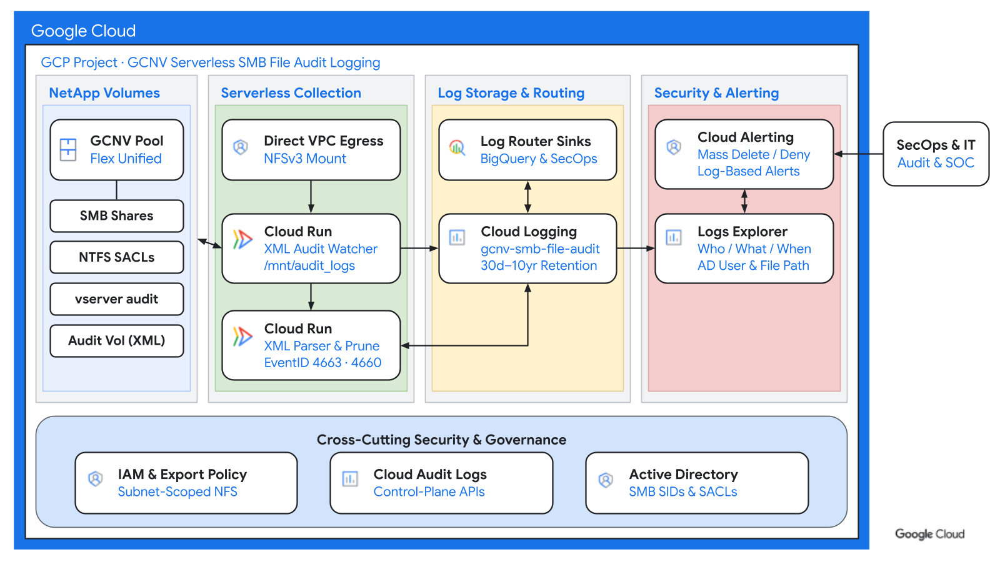

# Google Cloud NetApp Volumes SMB file access audit logging

This guide provides instructions and code to capture data-plane SMB file access audit events from Google Cloud NetApp Volumes and stream them into Google Cloud Logging using Cloud Run.



This solution supports:

- **Data-plane SMB event coverage**: Captures file reads, writes, renames, deletions, attribute changes, NTFS discretionary access control list (DACL) denials (`Audit Failure`), and SMB logon/logoff events (`Event IDs 4624, 4625, 4634, 4656, 4659, 4660, 4663, 9999`).
- **Active Directory identity attribution**: Preserves the authenticated Active Directory domain (`SubjectDomainName`), username (`SubjectUserName`), Windows security identifier (`SubjectUserSid`), client IP address, and file paths in structured `jsonPayload` entries.
- **Serverless NFS log collection**: Writes rotated ONTAP XML audit files to a dedicated UNIX security-style volume on the same Storage Virtual Machine (SVM) and mounts it natively on Cloud Run over Direct VPC Egress without Windows collector VMs or FPolicy servers.
- **Automatic staging cleanup**: Streams rotated XML files with constant memory (`xml.etree.ElementTree.iterparse`) and deletes processed files after Cloud Logging ingestion while skipping the active `audit_*_last.xml` file.

Requirements and limitations:

- **Service level and mode**: Requires a Google Cloud NetApp Volumes **Flex Unified** storage pool in **ONTAP-mode** joined to Active Directory for SMB. Standard, Premium, Extreme, and Default-mode Flex pools do not expose `vserver audit`.
- **Consolidation interval**: ONTAP rotates XML audit files on a 1-minute schedule (`-rotate-schedule-minute 0..59`), resulting in ~1 minute end-to-end delivery latency to Cloud Logging.
- **VPC connectivity**: Requires a VPC subnet in the same region with private routing to the storage pool's NAS Data LIF IP for Cloud Run Direct VPC Egress (`--vpc-egress=private-ranges-only`).

## Deployment steps

Clone the repository from GitHub and navigate to the sample directory:

```bash
git clone https://github.com/GoogleCloudPlatform/storage-samples.git
cd "storage-samples/NetApp Volumes/smb-file-access-audit"
```

### 1. Configure required roles and environment variables

Set your project, network, and NetApp Volumes Flex Unified pool variables:

```bash
export PROJECT_ID="your-gcp-project-id"
export REGION="us-central1"
export GCNV_LOCATION="us-central1-a"          # Location of your Flex Unified pool
export POOL_NAME="your-flex-unified-pool"
export SVM_NAME="your-svm-name"
export SVM_NFS_IP="10.x.x.x"                  # NAS Data LIF IP of the SVM
export VPC_NETWORK="your-vpc-network"
export VPC_SUBNET="your-cloudrun-subnet"
export SUBNET_CIDR="10.y.y.0/24"              # CIDR of VPC_SUBNET

export DATA_VOL_NAME="smb_shares_vol"
export TARGET_PATH="/${DATA_VOL_NAME}"        # SMB volume or subfolder path to audit
export AUDIT_VOL_NAME="audit_logs_vol"
export AUDIT_VOL_PATH="/${AUDIT_VOL_NAME}"
export EXPORT_POLICY_NAME="cloudrun_audit_nfs"
export SACL_POLICY_NAME="AuditSMBPolicy"
export NTFS_SD_NAME="AuditSMBSD"

export SERVICE_ACCOUNT_NAME="gcnv-smb-audit-sa"
export ARTIFACT_REPO="gcnv-audit"
export SERVICE_NAME="gcnv-smb-audit-collector"
export LOG_NAME="gcnv-smb-file-audit"

gcloud config set project "${PROJECT_ID}" --quiet
```

Enable the required Google Cloud services:

```bash
gcloud services enable \
    run.googleapis.com \
    artifactregistry.googleapis.com \
    cloudbuild.googleapis.com \
    logging.googleapis.com \
    netapp.googleapis.com \
    --project="${PROJECT_ID}" \
    --quiet
```

Create a dedicated service account for the Cloud Run collector and grant `roles/logging.logWriter`:

```bash
gcloud iam service-accounts create "${SERVICE_ACCOUNT_NAME}" \
    --display-name="GCNV SMB Audit Log Collector SA" \
    --description="Service account for the NetApp Volumes SMB audit collector" \
    --project="${PROJECT_ID}" \
    --quiet

export SA_EMAIL="${SERVICE_ACCOUNT_NAME}@${PROJECT_ID}.iam.gserviceaccount.com"

gcloud projects add-iam-policy-binding "${PROJECT_ID}" \
    --member="serviceAccount:${SA_EMAIL}" \
    --role="roles/logging.logWriter" \
    --quiet
```

### 2. Create the UNIX audit volume and NFS export policy

Create a dedicated 20 GiB UNIX security-style volume (`audit_logs_vol`) on the same SVM and expose it over NFS exclusively to the Cloud Run subnet.

Note two ONTAP export policy requirements:

- **Root junction traversal**: On ONTAP-mode pools, the SVM root volume (`/`) uses the `default` export policy, which starts with zero rules. Add a read-only rule on `default` so Cloud Run can traverse `/` to mount `/audit_logs_vol`.
- **NFSv3 and NFSv4 support**: Cloud Run's Gen2 NFS mounter attempts NFSv4.2 first before falling back on protocol errors, so set `-protocol nfs` (supporting both NFSv3 and NFSv4) on both export rules.

Allow read-only root traversal on the `default` export policy and create the subnet-scoped read-write export policy for `/audit_logs_vol`:

```bash
gcloud netapp storage-pools execute "${POOL_NAME}" \
    --project="${PROJECT_ID}" \
    --location="${GCNV_LOCATION}" \
    "vserver export-policy rule create -vserver ${SVM_NAME} -policyname default -clientmatch ${SUBNET_CIDR} -rorule sys -rwrule never -superuser sys -protocol nfs" \
    --quiet

gcloud netapp storage-pools execute "${POOL_NAME}" \
    --project="${PROJECT_ID}" \
    --location="${GCNV_LOCATION}" \
    "vserver export-policy create -vserver ${SVM_NAME} -policyname ${EXPORT_POLICY_NAME}" \
    --quiet

gcloud netapp storage-pools execute "${POOL_NAME}" \
    --project="${PROJECT_ID}" \
    --location="${GCNV_LOCATION}" \
    "vserver export-policy rule create -vserver ${SVM_NAME} -policyname ${EXPORT_POLICY_NAME} -clientmatch ${SUBNET_CIDR} -rorule sys -rwrule sys -superuser sys -anon 0 -protocol nfs" \
    --quiet
```

Look up the storage pool aggregate name (typically `aggr1`) and create the UNIX staging volume:

```bash
gcloud netapp storage-pools execute "${POOL_NAME}" \
    --project="${PROJECT_ID}" \
    --location="${GCNV_LOCATION}" \
    "volume show -fields aggregate" \
    --quiet

export AGGR_NAME="aggr1"

gcloud netapp storage-pools execute "${POOL_NAME}" \
    --project="${PROJECT_ID}" \
    --location="${GCNV_LOCATION}" \
    "volume create -vserver ${SVM_NAME} -volume ${AUDIT_VOL_NAME} -aggregate ${AGGR_NAME} -size 20GB -security-style unix -unix-permissions ---rwxrwxrwx -junction-path ${AUDIT_VOL_PATH} -policy ${EXPORT_POLICY_NAME}" \
    --quiet
```

### 3. Enable ONTAP XML auditing and NTFS SACLs

Configure `vserver audit` on the SVM to write rotated XML files (`-format xml`) into `/audit_logs_vol` every minute (`-rotate-schedule-minute 0..59`) or at 50 MB, and enable auditing:

```bash
gcloud netapp storage-pools execute "${POOL_NAME}" \
    --project="${PROJECT_ID}" \
    --location="${GCNV_LOCATION}" \
    "vserver audit create -vserver ${SVM_NAME} -destination ${AUDIT_VOL_PATH} -events file-ops,cifs-logon-logoff,file-share -format xml -rotate-size 50MB -rotate-schedule-minute 0..59 -rotate-limit 50" \
    --quiet

gcloud netapp storage-pools execute "${POOL_NAME}" \
    --project="${PROJECT_ID}" \
    --location="${GCNV_LOCATION}" \
    "vserver audit enable -vserver ${SVM_NAME}" \
    --quiet
```

Attach NTFS system access control lists (SACLs) for both `success` and `failure` events to the target SMB volume path using the ONTAP CLI (alternatively, configure SACLs from a Windows client under **Properties -> Security -> Advanced -> Auditing**):

```bash
gcloud netapp storage-pools execute "${POOL_NAME}" \
    --project="${PROJECT_ID}" \
    --location="${GCNV_LOCATION}" \
    "vserver security file-directory policy create -vserver ${SVM_NAME} -policy-name ${SACL_POLICY_NAME}" \
    --quiet

gcloud netapp storage-pools execute "${POOL_NAME}" \
    --project="${PROJECT_ID}" \
    --location="${GCNV_LOCATION}" \
    "vserver security file-directory ntfs create -vserver ${SVM_NAME} -ntfs-sd ${NTFS_SD_NAME}" \
    --quiet

gcloud netapp storage-pools execute "${POOL_NAME}" \
    --project="${PROJECT_ID}" \
    --location="${GCNV_LOCATION}" \
    "vserver security file-directory ntfs sacl add -vserver ${SVM_NAME} -ntfs-sd ${NTFS_SD_NAME} -access-type success -account Everyone -rights full-control -apply-to this-folder,sub-folders,files" \
    --quiet

gcloud netapp storage-pools execute "${POOL_NAME}" \
    --project="${PROJECT_ID}" \
    --location="${GCNV_LOCATION}" \
    "vserver security file-directory ntfs sacl add -vserver ${SVM_NAME} -ntfs-sd ${NTFS_SD_NAME} -access-type failure -account Everyone -rights full-control -apply-to this-folder,sub-folders,files" \
    --quiet

gcloud netapp storage-pools execute "${POOL_NAME}" \
    --project="${PROJECT_ID}" \
    --location="${GCNV_LOCATION}" \
    "vserver security file-directory policy task add -vserver ${SVM_NAME} -policy-name ${SACL_POLICY_NAME} -path ${TARGET_PATH} -security-type ntfs -ntfs-sd ${NTFS_SD_NAME}" \
    --quiet

gcloud netapp storage-pools execute "${POOL_NAME}" \
    --project="${PROJECT_ID}" \
    --location="${GCNV_LOCATION}" \
    "vserver security file-directory apply -vserver ${SVM_NAME} -policy-name ${SACL_POLICY_NAME}" \
    --quiet
```

### 4. Build and deploy the Cloud Run collector

Create an Artifact Registry repository and build the container image from the `code/` directory (`collector.py` and `Dockerfile`):

```bash
gcloud artifacts repositories create "${ARTIFACT_REPO}" \
    --repository-format=docker \
    --location="${REGION}" \
    --description="GCNV SMB File Audit Collector" \
    --project="${PROJECT_ID}" \
    --quiet

export IMAGE_URI="${REGION}-docker.pkg.dev/${PROJECT_ID}/${ARTIFACT_REPO}/${SERVICE_NAME}:v1"

gcloud builds submit code \
    --tag="${IMAGE_URI}" \
    --project="${PROJECT_ID}" \
    --quiet
```

Deploy the collector to Cloud Run with Direct VPC Egress, instance-based CPU billing (`--no-cpu-throttling`), and a native NFS volume mount targeting `${SVM_NFS_IP}:${AUDIT_VOL_PATH}`:

```bash
gcloud run deploy "${SERVICE_NAME}" \
    --image="${IMAGE_URI}" \
    --region="${REGION}" \
    --project="${PROJECT_ID}" \
    --service-account="${SA_EMAIL}" \
    --cpu=1 \
    --memory=512Mi \
    --no-cpu-throttling \
    --min-instances=1 \
    --max-instances=1 \
    --ingress=internal \
    --no-allow-unauthenticated \
    --network="${VPC_NETWORK}" \
    --subnet="${VPC_SUBNET}" \
    --vpc-egress=private-ranges-only \
    --execution-environment=gen2 \
    --add-volume="name=audit-logs,type=nfs,location=${SVM_NFS_IP}:${AUDIT_VOL_PATH}" \
    --add-volume-mount="volume=audit-logs,mount-path=/mnt/audit_logs" \
    --set-env-vars="AUDIT_MOUNT_DIR=/mnt/audit_logs,LOG_NAME=${LOG_NAME},STORAGE_POOL_NAME=${POOL_NAME},GCNV_LOCATION=${GCNV_LOCATION},DELETE_AFTER_INGEST=true" \
    --quiet
```

## How it works

### Protocol decoupling and XML ingestion

1. **SMB access and SACL evaluation**: Active Directory users access SMB shares on the NTFS volume (`smb_shares_vol`). File operations matching the NTFS SACL generate audit records inside ONTAP, capturing the Active Directory domain, username, SID, client IP, and object path.
2. **XML rotation to UNIX staging**: Every minute (`-rotate-schedule-minute 0..59`), ONTAP's `vserver audit` consolidation process writes completed events into a timestamped `audit_<svm>_D*.xml` file inside the UNIX security-style volume (`/audit_logs_vol`) while keeping active writes in `audit_<svm>_last.xml`.
3. **Cloud Run NFS polling and ingestion**: The Cloud Run service mounts `/audit_logs_vol` at `/mnt/audit_logs` over Direct VPC Egress, polls every 15 seconds (`POLL_INTERVAL_SEC`) for rotated `audit_*_D*.xml` files, parses `<Event>` elements into structured Cloud Logging entries under `log_id("gcnv-smb-file-audit")`, and deletes each processed XML file (`DELETE_AFTER_INGEST=true`).

### Audited Windows Security event IDs

| SMB operation | Event ID | `event_name` in Cloud Logging | Key `jsonPayload` fields |
| :--- | :--- | :--- | :--- |
| Authenticated SMB logon / logoff | `4624` / `4634` | `Logon Attempt` / `Logoff Attempt` | `client_ip`, `raw_event_data.TargetDomainName`, `raw_event_data.TargetUserName` |
| Failed SMB logon | `4625` | `Logon Failure` | `severity="WARNING"`, `result="Audit Failure"`, `raw_event_data.Status` |
| Open file or NTFS DACL access denied | `4656` | `Open Object` | `object_name`, `access_mask`, `raw_event_data.DesiredAccess` (`WARNING` on `Audit Failure`) |
| Read, write, or modify attributes | `4663` | `Read Object` / `Write Object` / `Set Object Attributes` | `object_name`, `raw_event_data.ReadCount` or `WriteCount`, `user_sid` |
| Rename or move file/folder | `9999` | `Rename Object` | `old_path`, `new_path`, `domain_name`, `user_name`, `user_sid` |
| Delete file or folder | `4659` / `4660` | `Open Object with Delete Intent` / `Delete Object Attempt` | `object_name`, `raw_event_data.InformationSet` (`Delete on last close;`) |

### Structured Cloud Logging event examples

#### File write (`event_id: 4663` - `Write Object`)

```json
{
  "logName": "projects/your-gcp-project-id/logs/gcnv-smb-file-audit",
  "severity": "INFO",
  "jsonPayload": {
    "event_id": 4663,
    "event_name": "Write Object",
    "result": "Audit Success",
    "domain_name": "CORP",
    "user_name": "jdoe",
    "user_sid": "S-1-5-21-1000000001-2000000002-3000000003-1105",
    "client_ip": "10.10.1.25",
    "object_type": "File",
    "object_name": "(smb_shares_vol);/finance/q4-forecast.xlsx",
    "handle_id": "00000000000402;00;00000060;00019199",
    "source_protocol": "CIFS",
    "storage_pool": "your-flex-unified-pool",
    "location": "us-central1-a",
    "svm": "gcnv-0123456789abcdef-r01/gcnv-0123456789abcdef-svm-01",
    "raw_event_data": {
      "ObjectName": "(smb_shares_vol);/finance/q4-forecast.xlsx",
      "ObjectType": "File",
      "SubjectDomainName": "CORP",
      "SubjectIP": "10.10.1.25",
      "SubjectUserIsLocal": "false",
      "SubjectUserName": "jdoe",
      "SubjectUserSid": "S-1-5-21-1000000001-2000000002-3000000003-1105",
      "WriteCount": "4096",
      "WriteOffset": "0"
    }
  }
}
```

#### File rename (`event_id: 9999` - `Rename Object`)

```json
{
  "logName": "projects/your-gcp-project-id/logs/gcnv-smb-file-audit",
  "severity": "INFO",
  "jsonPayload": {
    "event_id": 9999,
    "event_name": "Rename Object",
    "result": "Audit Success",
    "domain_name": "CORP",
    "user_name": "jdoe",
    "user_sid": "S-1-5-21-1000000001-2000000002-3000000003-1105",
    "client_ip": "10.10.1.25",
    "object_name": "(smb_shares_vol);/finance/q4-forecast-final.xlsx",
    "old_path": "(smb_shares_vol);/finance/q4-forecast.xlsx",
    "new_path": "(smb_shares_vol);/finance/q4-forecast-final.xlsx",
    "source_protocol": "CIFS",
    "storage_pool": "your-flex-unified-pool",
    "location": "us-central1-a",
    "svm": "gcnv-0123456789abcdef-r01/gcnv-0123456789abcdef-svm-01"
  }
}
```

#### File deletion (`event_id: 4660` - `Delete Object Attempt`)

```json
{
  "logName": "projects/your-gcp-project-id/logs/gcnv-smb-file-audit",
  "severity": "INFO",
  "jsonPayload": {
    "event_id": 4660,
    "event_name": "Delete Object Attempt",
    "result": "Audit Success",
    "domain_name": "CORP",
    "user_name": "jdoe",
    "user_sid": "S-1-5-21-1000000001-2000000002-3000000003-1105",
    "client_ip": "10.10.1.25",
    "object_type": "File",
    "object_name": "(smb_shares_vol);/finance/q4-forecast-final.xlsx",
    "handle_id": "00000000000402;00;00000060;00019199",
    "source_protocol": "CIFS",
    "storage_pool": "your-flex-unified-pool",
    "location": "us-central1-a",
    "svm": "gcnv-0123456789abcdef-r01/gcnv-0123456789abcdef-svm-01",
    "raw_event_data": {
      "InformationSet": "Delete on last close;",
      "ObjectName": "(smb_shares_vol);/finance/q4-forecast-final.xlsx",
      "ObjectType": "File",
      "SubjectDomainName": "CORP",
      "SubjectIP": "10.10.1.25",
      "SubjectUserIsLocal": "false",
      "SubjectUserName": "jdoe",
      "SubjectUserSid": "S-1-5-21-1000000001-2000000002-3000000003-1105"
    }
  }
}
```

#### Unauthorized file access (`event_id: 4656` - `Audit Failure`)

```json
{
  "logName": "projects/your-gcp-project-id/logs/gcnv-smb-file-audit",
  "severity": "WARNING",
  "jsonPayload": {
    "event_id": 4656,
    "event_name": "Open Object",
    "result": "Audit Failure",
    "domain_name": "CORP",
    "user_name": "contractor01",
    "user_sid": "S-1-5-21-1000000001-2000000002-3000000003-2104",
    "client_ip": "10.10.1.48",
    "object_type": "File",
    "object_name": "(smb_shares_vol);/hr/executive-compensation.xlsx",
    "access_mask": "89",
    "access_list": "%%4416 %%4419 %%4423",
    "source_protocol": "CIFS",
    "storage_pool": "your-flex-unified-pool",
    "location": "us-central1-a",
    "svm": "gcnv-0123456789abcdef-r01/gcnv-0123456789abcdef-svm-01",
    "raw_event_data": {
      "DesiredAccess": "Read Data; List Directory; Read Extended Attributes; Read Attributes;",
      "ObjectName": "(smb_shares_vol);/hr/executive-compensation.xlsx",
      "ObjectType": "File"
    }
  }
}
```

### Querying audit events in Logs Explorer

Use the following Cloud Logging queries in Logs Explorer or to configure Cloud Monitoring log-based alerts:

```text
# Force an immediate ONTAP log rotation during testing (run in Cloud Shell)
# gcloud netapp storage-pools execute "${POOL_NAME}" --project="${PROJECT_ID}" --location="${GCNV_LOCATION}" "vserver audit rotate-log -vserver ${SVM_NAME}" --quiet

# Track file deletions and renames across SMB shares
log_id("gcnv-smb-file-audit")
(jsonPayload.event_id=(4659 OR 4660 OR 9999) OR jsonPayload.raw_event_data.DesiredAccess:"Delete")

# Detect unauthorized file access or failed SMB logons
log_id("gcnv-smb-file-audit")
severity="WARNING" AND jsonPayload.result="Audit Failure"

# Audit all file activity for a specific Active Directory user
log_id("gcnv-smb-file-audit")
jsonPayload.domain_name="CORP" AND jsonPayload.user_name="jdoe"
```

## Clean up

To remove the audit collector resources without impacting existing SMB data volumes:

```bash
gcloud run services delete "${SERVICE_NAME}" \
    --region="${REGION}" \
    --project="${PROJECT_ID}" \
    --quiet

gcloud artifacts repositories delete "${ARTIFACT_REPO}" \
    --location="${REGION}" \
    --project="${PROJECT_ID}" \
    --quiet

gcloud iam service-accounts delete "${SA_EMAIL}" \
    --project="${PROJECT_ID}" \
    --quiet

gcloud netapp storage-pools execute "${POOL_NAME}" \
    --project="${PROJECT_ID}" \
    --location="${GCNV_LOCATION}" \
    "vserver audit disable -vserver ${SVM_NAME}" \
    --quiet

gcloud netapp storage-pools execute "${POOL_NAME}" \
    --project="${PROJECT_ID}" \
    --location="${GCNV_LOCATION}" \
    "volume unmount -vserver ${SVM_NAME} -volume ${AUDIT_VOL_NAME}" \
    --quiet

gcloud netapp storage-pools execute "${POOL_NAME}" \
    --project="${PROJECT_ID}" \
    --location="${GCNV_LOCATION}" \
    "volume offline -vserver ${SVM_NAME} -volume ${AUDIT_VOL_NAME}" \
    --quiet

gcloud netapp storage-pools execute "${POOL_NAME}" \
    --project="${PROJECT_ID}" \
    --location="${GCNV_LOCATION}" \
    "volume delete -vserver ${SVM_NAME} -volume ${AUDIT_VOL_NAME}" \
    --quiet
```
